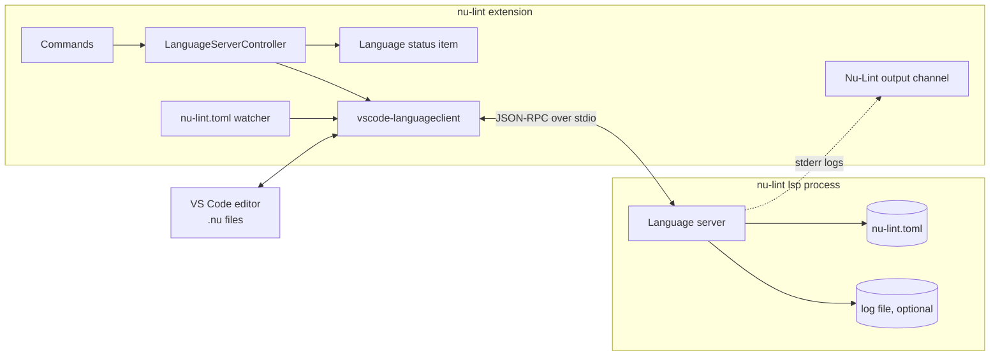
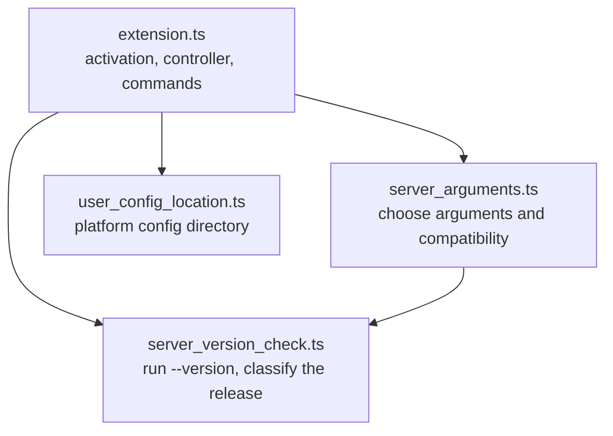
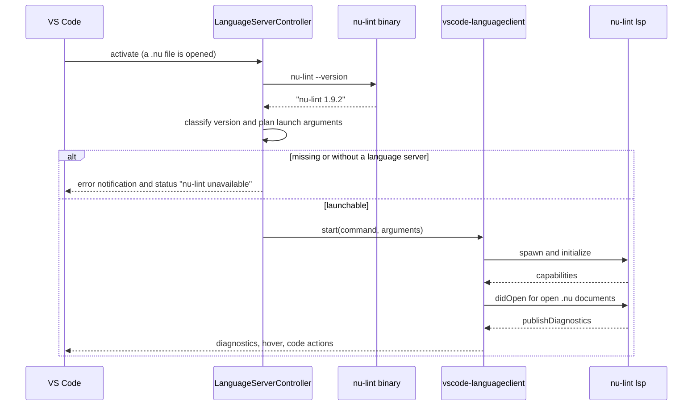
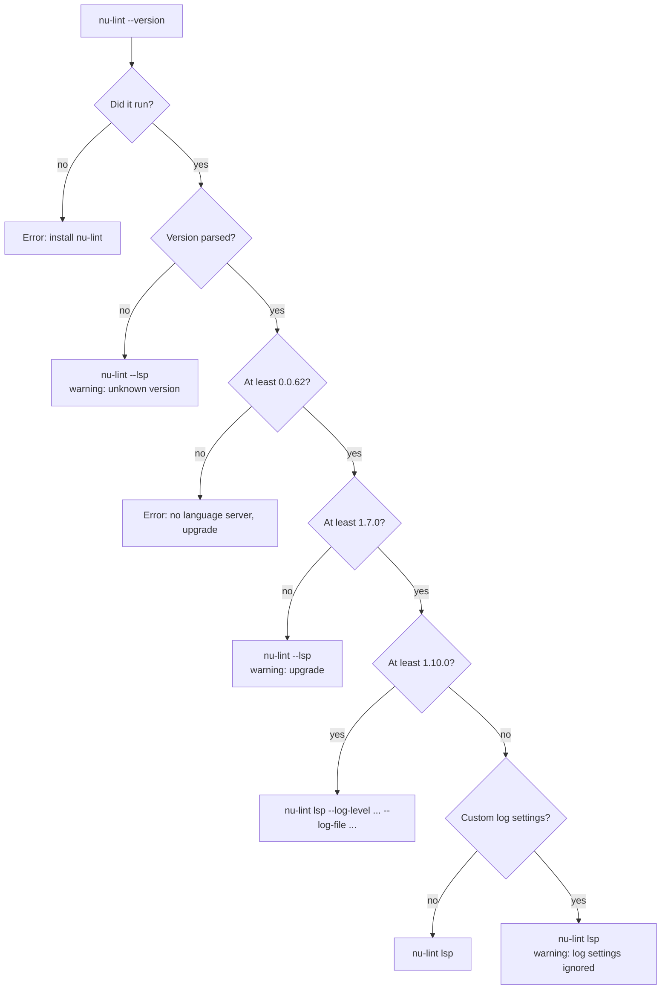
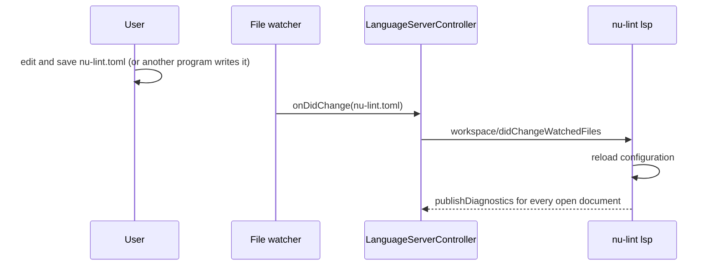
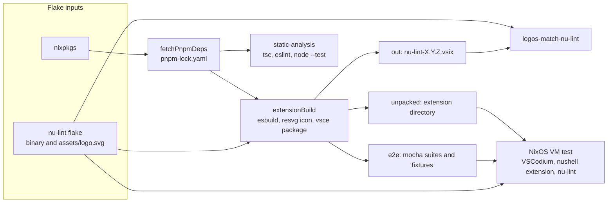
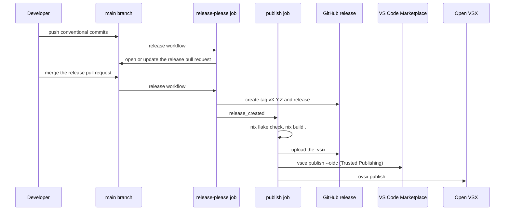

# Architecture

The extension is a thin client. All linting, fixes, hover documentation and rule configuration live in the nu-lint language server. The extension finds a usable `nu-lint` binary, starts it with the right arguments, forwards events VS Code would not send on its own, and adds a few commands on top.

## Components

VS Code only sends document events for files that match the extension's document selector, so the server would never learn that `nu-lint.toml` changed. The extension watches that file itself and forwards each change as `workspace/didChangeWatchedFiles`. The server then reloads the configuration and lints every open document again.

## Source modules

Pure logic lives in modules without a `vscode` import, so the Node.js test runner can unit test it. `extension.ts` wires them to the VS Code API.

| Module | Input | Output |
|---|---|---|
| `server_version_check.ts` | output of `nu-lint --version` | `current`, `legacy`, `outdated`, `unrecognized` or `missing` |
| `server_arguments.ts` | a launchable version and the log settings | command arguments and a compatibility level |
| `user_config_location.ts` | platform, home directory and environment | path of `nu-lint.toml`, matching the `dirs` crate nu-lint uses |

## Startup

Restarts go through one queue, so a quick series of setting changes never leaves two servers running.

## Compatibility with older nu-lint releases

Each warning appears once per session. While a server runs in a reduced mode, the language status item turns yellow and its detail shows the warning.

## Configuration reload

The *disable rule* code action takes another path: the server writes `nu-lint.toml` itself and reloads right away.

## Build and tests

The end-to-end tests are grouped per scenario under `test/e2e/<scenario>/`:

| File | Role |
|---|---|
| `default.nix` | the NixOS VM; it exposes the build outputs under `/etc/nu-lint-e2e` |
| `test_script.py` | the test driver: prepares a workspace, starts VSCodium, checks the report |
| `*_suite.ts` | the mocha suite that runs inside the VS Code extension host |
| `fixture_workspace/` | the files the suite opens |

The suites write a JSON report with passed and failed counts. The driver requires a minimum number of passed tests, so a VSCodium run that exits without running any suite cannot pass.

## Releases

The credentials for the last two steps are described in [secrets.md](secrets.md).
